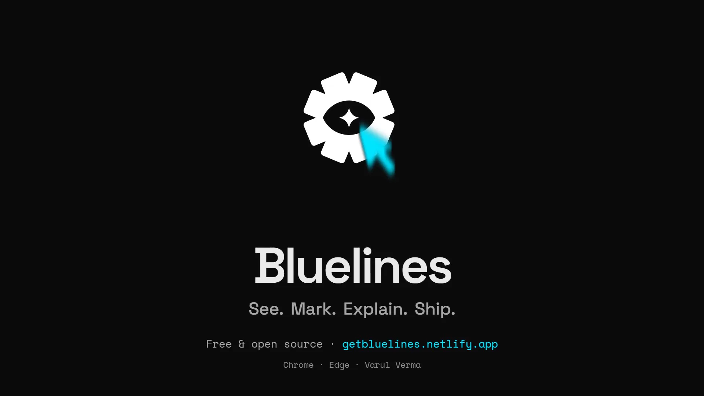
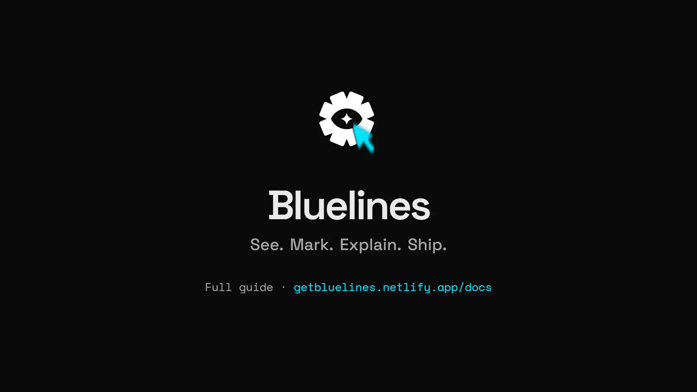

<p align="center">
  
</p>

<p align="center">
  <a href="#install"></a>
  <a href="#privacy"></a>
  <a href="#connect-to-ai-agents-mcp"></a>
  <a href="LICENSE"></a>
  <a href="CHANGELOG.md"></a>
</p>

<p align="center">
  <b>Bluelines</b> is a Chrome / Edge extension for marking up any web page like Figma comments.<br>
  Fully local and offline by default. An optional <b>Enhance</b> button turns a raw comment into a
  structured prompt for Claude / GPT / OpenRouter, and an optional local <b>MCP bridge</b> lets AI
  coding agents read your notes and work through them.
</p>

<p align="center">
  <a href="#install"><b>Install</b></a> ·
  <a href="#how-it-works"><b>How it works</b></a> ·
  <a href="#exports">Exports</a> ·
  <a href="#connect-to-ai-agents-mcp">AI agents</a> ·
  <a href="#privacy">Privacy</a> ·
  <a href="#reference">Reference</a>
</p>

<br>

## Watch it

<table>
  <tr>
    <td width="50%"><a href="https://getbluelines.netlify.app/docs/"></a></td>
    <td width="50%"><a href="https://getbluelines.netlify.app/docs/quickstart"></a></td>
  </tr>
  <tr>
    <td><b>Launch film · 60 s</b><br>Point at the button, pin the note, and let Claude Code fix it over MCP.<br><a href="https://getbluelines.netlify.app/docs/">Watch in the docs</a> · <a href="site/public/video/trailer.mp4">MP4</a> · <a href="site/public/video/trailer.vtt">captions</a></td>
    <td><b>How it works · 86 s</b><br>The full flow in 16 steps, from Inspect to a resolved note.<br><a href="https://getbluelines.netlify.app/docs/quickstart">Watch in the docs</a> · <a href="site/public/video/how-to.mp4">MP4</a> · <a href="site/public/video/how-to.vtt">captions</a></td>
  </tr>
</table>

Every frame is the real extension, captured live; music, no voice-over.

---

## How it works

<p align="center">
  
</p>

| | |
|---|---|
| **Pin anything** | Hover highlights elements, click to pin. A resilient selector, a structural fingerprint and a plain-language anchor (`button "Pay now" in form "Payment"`) are saved with every note, so it survives a re-render. |
| **Categorise** | Four built-in types — Text / Suggestion / Bug / Note — plus your own, remembered per page and per domain. |
| **Review** | A sidebar of cards, numbered pins on the page, and a full-screen table with search, type filters and a *This page / All pages* toggle. |
| **Ship it** | Export to Excel with embedded screenshots, HTML, CSV, print-ready PDF or a ZIP bundle. Copy as Markdown, JSON, XML, Notion, Linear or Jira. |
| **Hand to an agent** | A local MCP bridge lets Claude Code, Cursor, Windsurf or Codex read your notes: *"fix all open Bluelines bugs on localhost:3000"*. |
| **Local by default** | No account, no server, no telemetry. Notes and screenshots never leave the browser unless you click Enhance or Drive. |

---

## Install

1. Open `chrome://extensions`
2. Turn on **Developer mode** (top right)
3. Click **Load unpacked**
4. Select the `extension` folder inside this repo (the one with `manifest.json`)
5. Visit any webpage or local HTML file — for `file://` pages, enable **Allow access to file URLs** on the extension's details page

No build step, no dependencies.

### Keyboard shortcuts

| Shortcut | Action |
|---|---|
| `Alt+Shift+M` | Mark mode on/off. Use it to annotate inside an open dropdown, popup or modal dialog, where a click would close it first |
| `Alt+Shift+D` | Sidebar open/closed |
| `Alt+Shift+H` | Show/hide the floating button |
| `Esc` | Leave Mark mode / cancel the note form |

> The previous defaults (`Ctrl+Shift+D/P/M`) clash with browser shortcuts, so Chrome never assigned
> them. Chrome applies suggested shortcuts only on a fresh install — if you installed an earlier
> build, set them once at `chrome://extensions/shortcuts`.

---

## Using it

A small pill docks at the right edge of the screen with two icon buttons: a **target** (Mark) and a
**message bubble** (Notes), the latter badged with the current page's annotation count.

- **Mark** — click the target icon (or `Alt+Shift+M`) → hover highlights elements → click one → a
  form appears with category pills → write the note, save. **Escape** leaves Mark mode. **+ New**
  adds your own category; typing a built-in name such as "Bug" picks the built-in type.
- **Notes** — click the message icon for the sidebar: every annotation on the current page (keyed to
  the exact URL) as cards. Click a card to scroll to and highlight its element; if the page changed
  and the element is gone, the card says so and offers **Re-pin**.
- **Pins & compact view** — while the sidebar is open, numbered pins mark each annotated element
  (click a pin to jump to its card). The **rail icon** toggles compact view: a 56px column of
  numbered dots that expands on hover. Compact is the default and is remembered.
- **Card actions** — **Copy** (annotation as JSON), **Copy image** (screenshot only, so it pastes as
  a picture into Figma / Slack / Docs; either copy marks the card with a green **Copied** badge that
  persists), **Enhance** (rewrites it into a ready-to-paste AI coding prompt — needs an API key in
  Settings, opened from the toolbar popup) and **Delete** (with a few seconds of **Undo**).
- **General notes** — the **+** in the sidebar header adds a note with no element attached; **✕**
  closes the sidebar.
- **Edit** keeps the note's category unless you pick another, and keeps the original *Marked at*
  time (an `updatedAt` is stored too).
- **Table view** — the table icon opens a full-screen table (thumbnail, type, note, location,
  timestamp, actions) with search, type filters and a **This page / All pages** toggle. All pages
  groups notes by domain; notes from other pages can be deleted there, but not edited or copied.

The whole UI is a floating **liquid-glass** design — translucent panels with backdrop blur — and
follows your OS/browser light or dark theme automatically.

### Accessibility

Tab to the target button and press Enter for Mark mode, then Tab to a link, button or field on the
page and press Enter to mark it. Plain text can't take keyboard focus — use **+** for a general note
instead. Escape closes the open menu, table or sidebar and returns focus to where you were.

---

## Exports

The sidebar's Export menu always exports **this page**. The table view's Export and Copy menus
export whatever its **This page / All pages** toggle shows, and each menu names its scope at the
top. Search and type filters are **not** applied to exports. File names include `current-page` or
`all-pages`, and every row carries its page URL.

| Format | Where | What you get |
|---|---|---|
| **Excel** `.xlsx` | Sidebar + table | A real spreadsheet with each screenshot **embedded as an image** in the Screenshot column — `bluelines-<host>-<scope>-<date>.xlsx` |
| **HTML** | Sidebar + table | A standalone report with the same table and inline screenshots, opens in any browser |
| **CSV** | Table | Every cell quoted; values starting with `=`, `+`, `-` or `@` get a leading `'` so spreadsheets don't run them as formulas |
| **PDF** | Table | Downloads a `…-print.html` that opens the print dialog — choose "Save as PDF" |
| **ZIP** | Table | `annotations.json`, `report.html` and a `screenshots/` folder |
| **Google Drive** | Table (cloud icon) | Uploads that same `.xlsx` audit to your Drive — [one-time setup](#google-drive-setup-one-time) |

**Copy all annotations** (table view header) in a structured format — **Markdown**, **JSON**,
**XML**, **Notion**, **Linear** or **Jira** — one entry per annotation, each with its page URL. Text
formats carry a `hasScreenshot` flag rather than raw image bytes; the images live in the Excel and
HTML exports.

---

## Connect to AI agents (MCP)

AI tools that support MCP — Claude Code, Claude Desktop, Cursor, VS Code, Windsurf, Codex, Gemini
CLI — can read your notes and work through them:

> *"fix all open Bluelines bugs on localhost:3000"*

**You need:** Node.js 18+, an MCP-capable AI tool on the same computer, and the browser open.

1. **Settings → Connect to AI agents → On.** You get a private pairing code.
2. Enter the folder you loaded into Chrome; copy the ready-made command (Claude Code) or JSON
   (other tools' MCP config) and add it to your AI tool.
3. The status turns **Connected** once the AI tool starts the bridge (`mcp/bluelines-mcp.js`, no
   dependencies).

The toolbar popup's **AI agents** strip shows how many agents are connected and which ones. An
agent's chip blinks while it is reading or changing your notes. Hover it (or Tab to it) for detail:
how long it has been online, how many requests it made, how many notes it can see, how many open
notes you sent to it, and its last few requests.

**Tools the agent can call**

| Read | Write *(only when you allow changes)* |
|---|---|
| `get_overview`, `list_annotations` (filter by site, page, category, status, text), `get_annotation` (full detail plus screenshot), `get_current_page`, `show_annotation` (opens the page and highlights the element) | `resolve_annotation`, `reopen_annotation`, `reply_to_annotation`, `add_annotation` |

Notes come grouped **site → section → page → category**. The category is the one you chose, or, for
the generic default (`note` / `UI`), one inferred from the wording — Bug, Copy / text, Visual /
layout, Accessibility, Suggestion, Question. Each note says in words which element it points at,
with its selector and `data-testid`, so the agent can find the matching code.

**Security.** The bridge listens on `127.0.0.1` only and accepts only extension origins, so web
pages can't connect. It also needs your pairing code, so other programs can't either — *New pairing
code* revokes the old one. Only **shared sites** are visible (default: `localhost`, `*.local`,
`*.test`, `staging.*`, `dev.*`). Screenshots can be switched off. Agents are **read-only** unless
you allow changes, anything they write is labelled **AI**, and every access shows in
*Settings → Recent agent activity*. Several AI tools can be connected at once: each starts its own
bridge on the next free port (up to 10), and Bluelines connects to all of them.

---

## Privacy

- **Local by default.** Notes, screenshots and settings live only in this browser's extension
  storage. Marking, saving, viewing and all file exports work offline. No account, server, analytics
  or telemetry.
- **Enhance** — only when you click it — sends the note text, category, element selector and the
  page address **without** query string or `#fragment` to the AI provider you chose, using your own
  API key. No screenshots. You're asked once per provider first.
- **Send to Google Drive** — only when you click it — uploads the Excel export, screenshots
  included, to your Drive (`drive.file` scope: Bluelines sees only files it creates). You're asked
  once first. Opening Settings never contacts Google; **Disconnect** revokes access and forgets the
  account.
- Both actions respond only to your own clicks or key presses, never to scripts on the page.
- The API key and Google token are stored **unencrypted** in extension storage — other sites can't
  read them; anyone using this browser profile could.
- **AI agents** are off until you turn them on. An AI tool on this computer that you started with
  your pairing code can then read notes from your **shared sites** only. Bluelines talks only to
  `127.0.0.1`; the AI tool may send what it reads to its own provider.
- While a Bluelines panel is open, the page's own scripts can technically see what it shows. Avoid
  opening it on untrusted sites.
- Remove data by deleting notes, clearing the key in Settings, or removing the extension.

Details and the threat model: [`extension/docs/PRIVACY_AND_PERMISSIONS.md`](extension/docs/PRIVACY_AND_PERMISSIONS.md).

<details>
<summary><b>Permissions, and why each one is needed</b></summary>

<br>

| Permission | Why |
|---|---|
| `<all_urls>` | Show the UI on the pages you review, and take screenshots |
| `storage` + `unlimitedStorage` | Notes and screenshots |
| `scripting` | Enable Bluelines in tabs that were already open before install or an update |
| `identity` | Google Drive sign-in |
| `alarms` | Reconnect to a local AI tool every 30 s while *Connect to AI agents* is on |

</details>

---

## Reference

<details>
<summary><b>Data model</b> — per URL, in <code>chrome.storage.local</code></summary>

<br>

Key: `dn_annotations::<page URL without #fragment>` → array in creation order.

```js
{
  id,
  type,         // "text" | "suggestion" | "bug" | "note", or any custom category string
  text, selector,
  fingerprint,  // { tag, textHash, siblingIndex, parent } — fallback when the selector breaks
  anchor?,      // { describe, text, label, role, testId, component, classes, landmark, heading }
                //   e.g. describe: 'button "Pay now" in form "Payment" under "Checkout"'
  pageTitle?,   // document.title when the note was made
  rect,         // { top, left, width, height } in document coordinates at click time
  screenshot,   // PNG data URL or null
  timestamp,    // created ("Marked at"); never changed by edits
  updatedAt?,   // last edit
  copiedAt?,    // last Copy / Copy image
  status?,      // "open" (default when missing) | "resolved"
  resolvedAt?, resolvedBy?,  // "user" | "ai"
  replies?,     // [{ by: "ai" | "user", text, at }]
  source?       // "ai" when an AI agent added the note
}
```

Older notes without the optional fields keep working unchanged.

</details>

<details>
<summary><b>Pages and tabs</b> — where Bluelines can and can't run</summary>

<br>

- Tabs that were already open when you installed, reloaded or updated Bluelines get it the first
  time you use the toolbar popup or a shortcut there. A tab still showing the old floating button
  says *Refresh this page* when you click it.
- Browser pages (`chrome://…`, `edge://…`) and extension stores can't be annotated; the popup says
  so. Local `file://` pages need *Allow access to file URLs*.
- While a page shows a modal `<dialog>`, the Bluelines UI moves into the dialog so it stays usable.
- **URL keying** — notes belong to the exact URL without its `#fragment`, so hash-routed apps share
  one set of notes across routes, and the same page with different query strings has separate sets.

</details>

<details>
<summary><b>Google Drive setup</b> — one-time OAuth client</summary>

<br>

**Send to Google Drive** uses a manual OAuth flow (`chrome.identity.launchWebAuthFlow`), so you
paste your own OAuth client ID in **Settings** — no `manifest.json` editing required.

1. Open the extension's **Settings** page and copy the **Authorized redirect URI** shown under
   Google Drive (looks like `https://<extension-id>.chromiumapp.org/`).
2. In the [Google Cloud Console](https://console.cloud.google.com/): create or select a project →
   **APIs & Services** → enable the **Google Drive API**.
3. **Credentials → Create credentials → OAuth client ID → Application type: Web application** →
   under **Authorized redirect URIs**, paste the URI from step 1.
4. Copy the generated client ID into the **OAuth Client ID** field in Settings, and click
   **Check / connect**.

Scope is `drive.file` — the extension can only see and manage files it creates, never the rest of
your Drive. The access token lives about an hour and is cached in local storage; when it lapses the
extension re-auths silently if your Google session is still active, or shows the consent screen.

> The redirect URI is tied to the extension ID, which changes when you reload an unpacked build on a
> different machine. Pin it with a `"key"` in `manifest.json` (Chrome docs: *keep a consistent
> extension ID*), or update the Authorized redirect URI in the Cloud Console when the ID changes.

</details>

<details>
<summary><b>Known limitations</b> — and the obvious next steps</summary>

<br>

- **Selector fragility.** `selector.js` is best-effort: a stable id, test/aria attribute or semantic
  class first (generated ids and CSS-in-JS classes are skipped), then an nth-child path. A path hit
  is only trusted if it still looks like the saved element; otherwise a structural fingerprint
  (tag + text + position) is tried, and if no single element matches, the note shows **Element not
  found** with a **Re-pin** button rather than pointing at the wrong thing. Iframes and shadow DOM
  are not supported. React component names aren't visible to content scripts, so the anchor relies
  on `data-component` / `data-testid`.
- **Screenshots cover the visible viewport only.** The element is scrolled back into view before
  capture, but anything taller or wider than the window is cut off. Scroll-and-stitch capture is a
  possible v2.
- **No sync across devices** — by design, local-first. If team collaboration is ever wanted,
  swapping `chrome.storage.local` for a Supabase-backed store is the smallest lift.
- **CSS isolation** uses `all: revert` under `#designnote-root` rather than a full shadow DOM —
  works well in practice, but a shadow DOM wrapper would be more bulletproof against aggressive
  host-page CSS.

</details>

---

## Browser support

One manifest, no build step. Test evidence: [`extension/docs/`](extension/docs/).

| Browser | Status |
|---|---|
| **Chrome** (desktop) | ✅ **Tested** — Chrome 155, automated suites in `tests/` (first-release target) |
| **Microsoft Edge** (desktop) | ✅ **Tested** — Edge 156, same suites |
| Brave, Arc, Opera, Vivaldi | ⚪ Not yet verified — Chromium-based, expected to behave like Chrome |
| Firefox / Zen 121+ | ⚪ Not yet verified — the manifest carries the Firefox settings, but it has never been loaded in Firefox |
| Safari | ❌ Not supported — would need `xcrun safari-web-extension-converter` |

- **Chromium:** `chrome://extensions` (or `edge://extensions`) → Developer mode → Load unpacked.
- **Firefox / Zen:** `about:debugging#/runtime/this-firefox` → Load Temporary Add-on → pick
  `manifest.json`. Grant site access if prompted. For Google Drive, register the redirect URL shown
  on the settings page (it differs per browser).

`manifest.json` declares both `background.service_worker` (Chrome/Edge) and `background.scripts`
(Firefox, which ignores `service_worker`). This is the cross-browser pattern MDN recommends and
Chrome 121+ accepts without warnings — verified, no install warnings in Chrome 155. **Keep both.**

---

<p align="center">
  <sub>
    <a href="extension/docs/GUIDE.md">Guide</a> ·
    <a href="CHANGELOG.md">Changelog</a> ·
    <a href="SECURITY.md">Security</a> ·
    <a href="LICENSE">MIT</a>
    &nbsp;—&nbsp; built by <a href="https://github.com/varulverma">Varul Verma</a>
  </sub>
</p>
