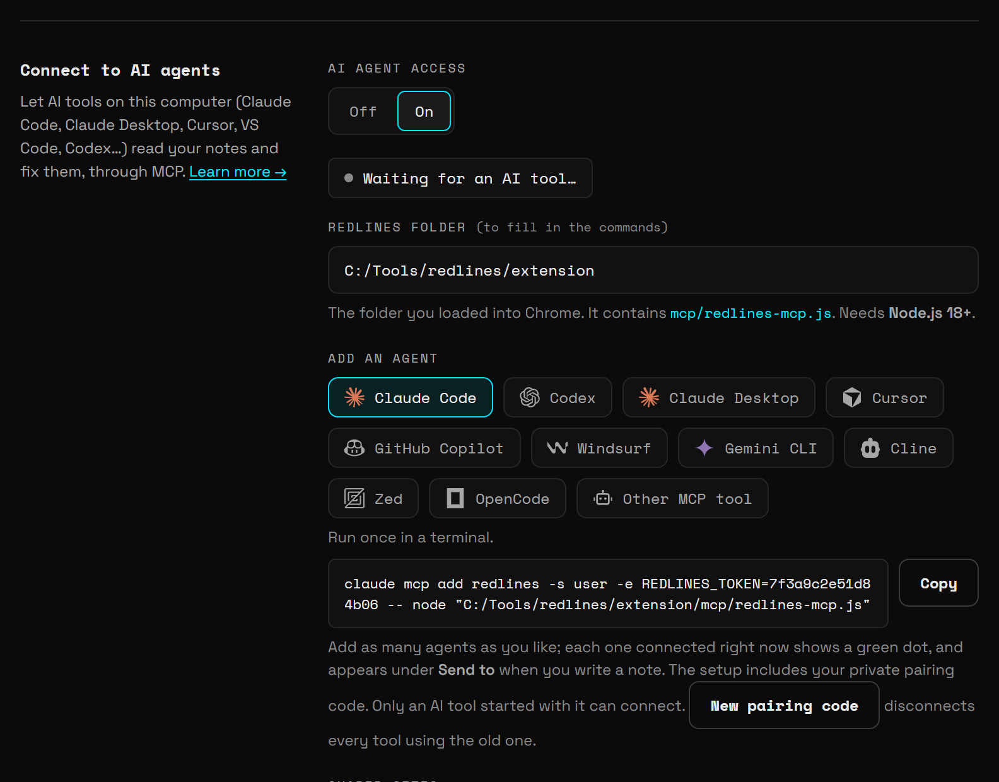

**Connect to AI agents** lets an AI tool on your computer read the notes you pinned on your pages, find the matching code, fix it, and mark the notes resolved. It works with any tool that supports MCP (Model Context Protocol): Claude Code, Codex, Claude Desktop, Cursor, GitHub Copilot in VS Code, Windsurf, Gemini CLI, Cline, Zed, OpenCode, and others.

Once it is connected, you can ask your agent things like:

```text
fix all open Bluelines bugs on localhost:3000
```

The agent lists your open notes, sees which element each one points at (in words, plus its CSS selector and `data-testid`), edits your code, and resolves each note with a short reply about what it changed.

It is **off** until you turn it on, and agents are **read-only** until you allow changes.

## How it works

Bluelines ships a small MCP server, `mcp/bluelines-mcp.js`, inside the extension folder. It has no dependencies.

1. Your AI tool starts that server with your pairing code.
2. The server waits on your computer at `127.0.0.1`.
3. The Bluelines extension connects to it, proves the pairing code, and answers the agent's questions about your notes.

Nothing goes through a Bluelines server. There is none.

## What you need

- **Node.js 18 or later.** Check it in a terminal:

  ```bash
  node --version
  ```

  The output must be `v18` or higher.
- **An MCP-capable AI tool** on the same computer.
- **The browser open**, with Bluelines installed. The agent reads your notes from the running extension.

## Step 1: Turn it on

1. Open the toolbar popup and click **Settings** (or click **Set up** in the popup's **AI agents** strip).
2. Go to **Connect to AI agents**.
3. Under **AI agent access**, choose **On**.
4. Bluelines asks you to confirm:

   ```text
   Let AI tools on this computer read your Bluelines notes?

   An AI tool you start with your pairing code can read notes from your shared sites: text, element details, page addresses and (if allowed) screenshots. The AI tool may send what it reads to its provider.

   You can turn this off at any time.
   ```

5. Click **OK**. Bluelines creates your private pairing code and shows the setup options.

If you click **Cancel**, access stays **Off**.

## Step 2: Enter your Bluelines folder

In **Bluelines folder**, enter the folder you loaded into Chrome with **Load unpacked**. It is the folder that contains `manifest.json` and an `mcp` folder.

Bluelines builds the server path from it:

```text
<folder>/mcp/bluelines-mcp.js
```

For example, if you loaded `/Users/you/bluelines`, the server is at:

```text
/Users/you/bluelines/mcp/bluelines-mcp.js
```

On Windows, if you loaded `C:\Users\you\bluelines\extension`, the server is at:

```text
C:\Users\you\bluelines\extension\mcp\bluelines-mcp.js
```

Bluelines uses the slash style of the folder you type, and ignores a trailing slash. The field is only used to fill in the commands below. You can leave it empty and edit the path in the command yourself.

> **Note:** If you move or rename the extension folder later, update this field and copy the setup again.

## Step 3: Pick your agent and copy the setup

Under **Add an agent**, click your AI tool. Bluelines shows where the setup goes and the exact command or JSON for that tool, with your pairing code and server path already filled in. Click **Copy** next to it.



> **Note:** Copying from Settings is the easiest way. The examples below use `<your-pairing-code>` and an example path. Settings fills in your real code and path for you.

Add as many agents as you like. Every agent uses the same pairing code.

### Claude Code

**Where:** Run once in a terminal.

macOS or Linux:

```bash
claude mcp add bluelines -s user -e BLUELINES_TOKEN=<your-pairing-code> -- node "/Users/you/bluelines/mcp/bluelines-mcp.js"
```

Windows:

```bash
claude mcp add bluelines -s user -e BLUELINES_TOKEN=<your-pairing-code> -- node "C:\Users\you\bluelines\extension\mcp\bluelines-mcp.js"
```

`-s user` adds Bluelines for your user account, so it is available in every project.

### Codex

**Where:** Run once in a terminal.

```bash
codex mcp add bluelines --env BLUELINES_TOKEN=<your-pairing-code> -- node "/Users/you/bluelines/mcp/bluelines-mcp.js"
```

### Claude Desktop

**Where:** Settings → Developer → Edit Config: add to `claude_desktop_config.json`, then restart Claude.

```json
{
  "mcpServers": {
    "bluelines": {
      "command": "node",
      "args": [
        "/Users/you/bluelines/mcp/bluelines-mcp.js"
      ],
      "env": {
        "BLUELINES_TOKEN": "<your-pairing-code>"
      }
    }
  }
}
```

If the file already has an `mcpServers` object, add the `bluelines` entry inside it instead of adding a second `mcpServers`.

### Cursor

**Where:** Add to `~/.cursor/mcp.json` (or Cursor Settings → MCP → Add new server).

```json
{
  "mcpServers": {
    "bluelines": {
      "command": "node",
      "args": [
        "/Users/you/bluelines/mcp/bluelines-mcp.js"
      ],
      "env": {
        "BLUELINES_TOKEN": "<your-pairing-code>"
      }
    }
  }
}
```

### GitHub Copilot

**Where:** VS Code: add to `.vscode/mcp.json`, or run "MCP: Open User Configuration".

```json
{
  "servers": {
    "bluelines": {
      "type": "stdio",
      "command": "node",
      "args": [
        "/Users/you/bluelines/mcp/bluelines-mcp.js"
      ],
      "env": {
        "BLUELINES_TOKEN": "<your-pairing-code>"
      }
    }
  }
}
```

VS Code uses a `servers` key and `"type": "stdio"`, not `mcpServers`.

### Windsurf

**Where:** Add to `~/.codeium/windsurf/mcp_config.json`.

```json
{
  "mcpServers": {
    "bluelines": {
      "command": "node",
      "args": [
        "/Users/you/bluelines/mcp/bluelines-mcp.js"
      ],
      "env": {
        "BLUELINES_TOKEN": "<your-pairing-code>"
      }
    }
  }
}
```

### Gemini CLI

**Where:** Add to `~/.gemini/settings.json`.

```json
{
  "mcpServers": {
    "bluelines": {
      "command": "node",
      "args": [
        "/Users/you/bluelines/mcp/bluelines-mcp.js"
      ],
      "env": {
        "BLUELINES_TOKEN": "<your-pairing-code>"
      }
    }
  }
}
```

If `settings.json` already has other settings, merge the `mcpServers` key into it.

### Cline

**Where:** Cline → MCP Servers → Configure: add to `cline_mcp_settings.json`.

```json
{
  "mcpServers": {
    "bluelines": {
      "command": "node",
      "args": [
        "/Users/you/bluelines/mcp/bluelines-mcp.js"
      ],
      "env": {
        "BLUELINES_TOKEN": "<your-pairing-code>"
      }
    }
  }
}
```

### Zed

**Where:** Add to Zed `settings.json`.

```json
{
  "context_servers": {
    "bluelines": {
      "command": "node",
      "args": [
        "/Users/you/bluelines/mcp/bluelines-mcp.js"
      ],
      "env": {
        "BLUELINES_TOKEN": "<your-pairing-code>"
      }
    }
  }
}
```

Zed uses a `context_servers` key. Merge it into your existing settings.

### OpenCode

**Where:** Add to `opencode.json`.

```json
{
  "mcp": {
    "bluelines": {
      "type": "local",
      "command": [
        "node",
        "/Users/you/bluelines/mcp/bluelines-mcp.js"
      ],
      "environment": {
        "BLUELINES_TOKEN": "<your-pairing-code>"
      }
    }
  }
}
```

OpenCode uses `mcp`, `"type": "local"`, a `command` array, and `environment` (not `env`).

### Other MCP tool

**Where:** Add to your tool's MCP config file (most tools use this format).

```json
{
  "mcpServers": {
    "bluelines": {
      "command": "node",
      "args": [
        "/Users/you/bluelines/mcp/bluelines-mcp.js"
      ],
      "env": {
        "BLUELINES_TOKEN": "<your-pairing-code>"
      }
    }
  }
}
```

> **Note:** In JSON, a Windows path needs doubled backslashes, for example `"C:\\Users\\you\\bluelines\\extension\\mcp\\bluelines-mcp.js"`. The JSON that Settings copies is already escaped correctly.

## Step 4: Start the agent and check the status

Start your AI tool, or restart it if it was already running, so it loads the new MCP server. The tool starts `bluelines-mcp.js` itself. You don't run it by hand.

Back in **Settings → Connect to AI agents**, the status line shows one of three messages:

| Status | Meaning |
|---|---|
| **Connected to AI tools** | At least one AI tool is connected. It is ready. |
| **Waiting for an AI tool to start the Bluelines MCP server…** | No AI tool has started the server yet. Start or restart your tool. Bluelines checks again every 30 seconds. |
| **An AI tool tried to connect with an old pairing code. Copy the command again.** | The tool was set up with a code you have since replaced. Copy the setup again and update the tool. |

When an agent connects, its logo and name appear under the status, and its tile under **Add an agent** gets a green dot.

Now try it. In your agent, ask:

```text
What Bluelines notes are open on localhost:3000?
```

## The AI agents strip in the popup

The toolbar popup has an **AI agents** strip. On the right it shows **Off**, or how many agents are connected, for example **2 connected**.

- **Each connected agent has a chip** with its logo and name. Two sessions of the same tool show as one chip with a count, for example **×2**.
- **The chip blinks while the agent is working**, reading or changing your notes, and for a moment after each request.
- **Click a chip** to open Settings.
- **Hover a chip, or Tab to it**, to see its card:
  - **Connected** or **Working…**
  - **Online for:** how long it has been connected, and the number of sessions.
  - **Requests:** how many requests it has made.
  - **Can see:** how many notes it can read (shown "after its first request").
  - **Sent to it:** how many open notes you sent to this agent.
  - Its last three requests, with how long ago each happened.

Below the chips, the strip shows a hint when there is something to do:

- Off: "Let Claude Code, Cursor and other AI tools read your notes." with a **Set up** button.
- On, with no agent yet: "Waiting for an AI tool to start the Bluelines MCP server."
- Old code: "An AI tool used an old pairing code. Copy the setup command again in Settings." with an **Open Settings** button.

## Shared sites

Agents can only see notes on the sites in **Shared sites**. Notes on every other site stay private.

The default list is:

```text
localhost 127.0.0.1 *.localhost *.local *.test staging.* dev.*
```

That covers local development and typical staging hosts, but not your live production site.

Separate entries with spaces. Each entry is matched against the page's host name, without the port:

| Entry | Matches | Example |
|---|---|---|
| `localhost` | That exact host, on any port | `http://localhost:3000/checkout` |
| `*.example.com` | Any subdomain of `example.com` | `app.example.com`, `qa.app.example.com` |
| `staging.*` | Any host that starts with `staging.` | `staging.example.com` |
| `file` | Local files opened from disk | `file:///Users/you/site/index.html` |

`*.example.com` does not match `example.com` itself. Add both if you need both. Only `http`, `https` and (with `file`) local file pages can be shared.

Examples:

```text
localhost 127.0.0.1 *.local *.test staging.* dev.* preview.myapp.com
```

```text
localhost file
```

> **Note:** A note you send to a specific agent (see [Send notes to an agent](/docs/send-to-agent)) is visible to that agent even if its site is not shared. Sending it is how you share that one note.

## Permissions

Under **Agents may also**:

- **See screenshots** (on by default). The agent can see the screenshot of each note's element as an image. Turn it off to share text and element details only.
- **Resolve, reply and add notes** (off by default). Without it, agents are **read-only**: they can list, read and show notes, but every change is refused with a message telling them you haven't allowed changes. Turn it on to let agents resolve and reopen notes, reply to them, and pin new notes.

Anything an agent writes is labelled **AI** in your sidebar: notes it adds get an **AI** tag, and its replies show **AI** instead of **You**.

## Recent agent activity

**Recent agent activity** lists the last 12 things agents did, newest first, with the time. For example:

- Listed notes: 14 notes
- Read a note: *(the note text)*
- Checked the open page: *(host)*
- Showed a note: *(the note text)*
- Resolved a note, Reopened a note, Replied to a note, Added a note

Click **Clear** to empty the list. Until an agent does something, it says "No agent activity yet."

## Pairing code

Your pairing code is created when you first turn access on. It is part of every setup command and JSON. Only an AI tool started with the current code can connect.

To replace it, click **New pairing code**. This disconnects every tool that uses the old code straight away. Then copy the setup again for each agent you want to keep, and update it in that tool (for Claude Code and Codex, remove the old `bluelines` server first, then run the new command).

Replace your code if you shared a config file by mistake, or if you want to cut off every agent at once.

## Several agents at once

You can connect several AI tools at the same time, for example Claude Code in one project and Cursor in another.

Each tool starts its own copy of the server, which takes the next free port from **17337** to **17346** (10 ports). Bluelines connects to every one of them, and checks for new ones every 30 seconds. If all ten ports are taken, the eleventh tool reports that ten AI tools are already connected and asks you to close one.

See [Use several agents](/docs/guide-multiple-agents) for a walkthrough.

## Security model

- **Local only.** The server listens on `127.0.0.1`, so other computers on your network can't reach it.
- **Extension only.** It accepts connections only from browser extension origins, so web pages you visit can't connect to it.
- **Pairing code.** The extension must present your pairing code before the server uses it, so other programs on your computer can't pose as Bluelines.
- **Your sites only.** Agents see only notes from your shared sites, plus notes you send to them directly.
- **Your choice of what they see and do.** Screenshots can be switched off, and agents can't change anything unless you allow it.
- **Everything is logged** in **Recent agent activity**, and everything an agent writes is labelled **AI**.
- **Off switch.** Set **AI agent access** to **Off** and every connection closes.

> **Warning:** Your AI tool may send what it reads, including note text, page addresses, element details and screenshots, to its own AI provider, as with anything else you show it. Share only sites you are comfortable sending to that provider.

The pairing code is stored unencrypted in the extension's storage, like your other settings. See [Privacy](/docs/privacy).

## Troubleshooting

| Problem | Fix |
|---|---|
| Status stays at **Waiting for an AI tool to start the Bluelines MCP server…** | Restart your AI tool so it loads the config. Check the path in the command points at a real `mcp/bluelines-mcp.js` file, and that `node --version` shows 18 or later. |
| **An AI tool tried to connect with an old pairing code. Copy the command again.** | You clicked **New pairing code** after setting up that tool. Copy the setup again and replace the old entry in the tool. |
| The agent says "The Bluelines extension is not connected. Open Chrome, and check Bluelines settings → Connect to AI agents is on (it reconnects within 30 seconds)." | Open the browser, make sure access is **On**, and wait up to 30 seconds. |
| The agent says "Bluelines is not paired." | The tool was set up without `BLUELINES_TOKEN`. Copy the full setup from Settings and add the server again. |
| The agent says "AI agents can read Bluelines notes but not change them." | Turn on **Resolve, reply and add notes** if you want the agent to make changes. |
| The agent finds no notes, or says the open page is not shared | Add that site to **Shared sites**, or send the note to the agent directly. |
| The agent says "That site is not shared with AI agents in Bluelines settings." when adding a note | Add the site to **Shared sites**. |
| The agent reports that ports 17337–17346 are all in use | Ten AI tools are already connected. Close one you don't need. |
| `node` is not found | Install Node.js 18 or later, then restart your AI tool. |
| Screenshots don't reach the agent | Turn on **See screenshots**. Notes made without a screenshot have none to share. |
| The agent's chip doesn't appear in the popup | The chip appears once the extension has connected to the agent's server. Wait up to 30 seconds after the tool starts, then reopen the popup. |

More fixes are in [Troubleshooting](/docs/troubleshooting).

## Next

- [Send notes to an agent](/docs/send-to-agent): hand specific notes to a specific agent.
- [MCP tools reference](/docs/mcp-tools): every tool the agent can call.
- [Fix notes with Claude Code](/docs/guide-claude-code-fix): a full walkthrough.
