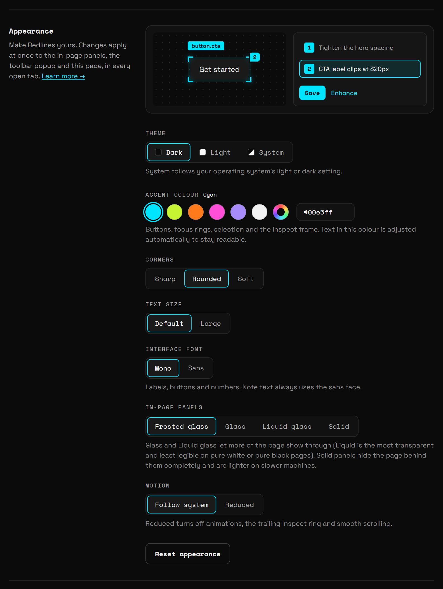

Bluelines is yours to tune. Every Appearance control applies at once to the in-page panels, the toolbar popup and the Settings page, in every open tab. You don't need to save or reload anything.

## Open Appearance

1. Click the Bluelines icon in your browser toolbar.
2. Click **Settings**.
3. **Appearance** is the first section.

You can also open Settings from `chrome://extensions`: find Bluelines, click **Details**, then **Extension options**.

## Live preview

The top of the section shows a small copy of the in-page UI: a framed **Get started** button with its `button.cta` selector chip and a numbered pin, next to a notes panel with a **Save** button and an **Enhance** link. It is drawn from the same settings as the real thing, so you see each change there before you go back to a page.

## Theme

| Option | What it does |
|---|---|
| **Dark** | The default. Ink panels with light text. |
| **Light** | Paper panels with dark text. |
| **System** | Follows your operating system's light or dark setting, and switches when it does. |

## Accent colour

The accent colours buttons, focus rings, selection and the Inspect frame. Pick one of six presets:

| Preset | Hex |
|---|---|
| Cyan (default) | `#00e5ff` |
| Lime | `#c6f432` |
| Orange | `#ff7a1a` |
| Pink | `#ff4fd8` |
| Violet | `#a78bfa` |
| White | `#f2f2f2` |

For any other colour, click the colour wheel after the presets, or type a hex code such as `#ff4fd8` into the field beside it and press <kbd>Enter</kbd>. The name next to **Accent colour** shows the preset you picked, or **Custom**.

Text drawn in the accent colour is adjusted automatically so it stays readable on both themes. The hint under the swatches warns you when a colour may cause trouble:

- **Close to a category colour.** A red, blue, amber, grey or green accent sits near the Bug, Suggestion, Text or Note category colours, or the green "saved" colour. Notes and highlights become harder to tell apart.
- **Very dark on the dark theme.** Focus rings and the Inspect frame will be hard to see.
- **Very light on the light theme.** Rings and fills will be hard to see. Text in the colour is darkened for you.

> **Tip:** If several people review the same site, give each person a different accent so screen recordings and screenshots show whose session is whose.

## Corners

| Option | What it does |
|---|---|
| **Sharp** | Square corners, 2 to 3 px at most. |
| **Rounded** | The default. Small, even radii. |
| **Soft** | Larger radii, up to 18 px on panels. |

## Text size

| Option | What it does |
|---|---|
| **Default** | The standard size. |
| **Large** | Raises every text step by about one pixel. Labels, buttons, notes and the table all get bigger. |

## Interface font

| Option | What it does |
|---|---|
| **Mono** | The default. Space Mono for labels, buttons and numbers. |
| **Sans** | Space Grotesk for labels, buttons and numbers. |

Note text always uses the sans face (Space Grotesk), whichever you choose.

## In-page panels

This sets the material of the sidebar, table, note form and menus that Bluelines draws on top of the page you're reviewing. It doesn't change the popup or Settings.

| Option | What you see | When to use it |
|---|---|---|
| **Frosted glass** | The default. A tinted, blurred panel that hints at the page behind it. | Most pages. A good balance of context and legibility. |
| **Glass** | More see-through, with a lighter blur and a bright top edge. Body text stays readable on white and near-black pages. | When you want to keep more of the page in view while you read notes. |
| **Liquid glass** | The most transparent option: barely tinted, with a bright edge. The page behind is darkened or lifted so text stays legible. | Mid-tone, colourful or photographic pages. |
| **Solid** | Opaque panels with no blur. The page behind is hidden completely. | Busy or high-contrast pages, long reading sessions, screen recordings, and slower machines (no blur to render). |

> **Note:** Liquid glass has the weakest contrast on pages that are pure white or pure black. If notes look faint there, switch to Frosted glass or Solid.

## Motion

| Option | What it does |
|---|---|
| **Follow system** | The default. Uses your operating system's reduce-motion setting. |
| **Reduced** | Turns off animations, the trailing ring that follows your pointer in Inspect Mode, and smooth scrolling, whatever your system says. |

## Reset

Click **Reset appearance** to go back to the defaults. "Back to defaults." appears beside the button.

Reset puts the accent back to Cyan, Corners to Rounded, Text size to Default, Interface font to Mono, In-page panels to Frosted glass and Motion to Follow system. It also resets **Page pins** to Show and **Note colours** to Accent from the [Workspace](/docs/workspace) section. It doesn't change your **Theme**, how the sidebar opens, or your categories.
