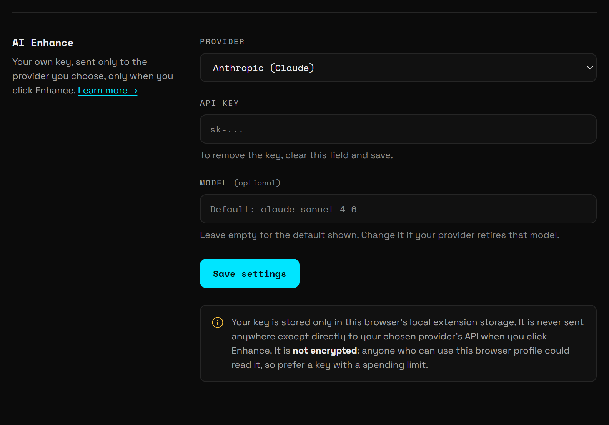

**Enhance** rewrites one note into a single, specific instruction that an AI coding assistant can act on. Bluelines sends the note to the AI provider you choose, with your own API key, and copies the result to your clipboard. Paste it into Claude Code, Cursor, ChatGPT or any other tool.

Enhance is off until you add a key. Nothing is sent until you click **Enhance** on a note.

## Set it up

1. Open the toolbar popup and click **Settings**.
2. Go to **AI Enhance**.
3. Pick a **Provider**.
4. Paste your key into **API key**.
5. Optional: type a model ID in **Model**.
6. Click **Save settings**. You see **Saved.**



To remove the key later, clear the **API key** field and click **Save settings** again.

### Providers

| Provider (as listed in Settings) | Where to get a key | Default model |
|---|---|---|
| **Anthropic (Claude)** | The Anthropic Console (`console.anthropic.com`) | `claude-sonnet-4-6` |
| **OpenAI (GPT)** | The OpenAI Platform (`platform.openai.com`) | `gpt-4o-mini` |
| **OpenRouter** | Your OpenRouter account (`openrouter.ai`) | `anthropic/claude-sonnet-4.5` |

Each provider bills your own account for the requests. A reply is capped at 300 tokens, so one Enhance costs very little.

> **Warning:** Your key is stored in this browser's extension storage and is **not encrypted**. Anyone who can use this browser profile could read it. Use a key with a spending limit.

### The Model field

**Model** is optional. Leave it empty and Bluelines uses the default model for the provider, which the field shows as its placeholder (for example `Default: claude-sonnet-4-6`).

Type a model ID only if you want a different model, or if your provider retires the default. Use the provider's exact model ID. For OpenRouter that includes the vendor prefix, as in the default `anthropic/claude-sonnet-4.5`.

## Use it

1. Open the sidebar (<kbd>Alt</kbd>+<kbd>Shift</kbd>+<kbd>D</kbd>) or the table view.
2. On a note, click **Enhance** (the sparkles icon). Its tooltip reads "Rewrite this note as an AI prompt with your AI provider (asks first)".
3. The first time you use a provider, Bluelines asks for your consent (see below).
4. You see **Enhancing prompt…**, then **Enhanced prompt copied to clipboard!**
5. Paste the prompt where you need it.

Enhance runs only when you click or press the button yourself. Scripts on the page can't trigger it.

### The one-time consent

Before the first send to each provider, Bluelines shows this dialog (shown here for Anthropic):

```text
Enhance sends this note to Anthropic (Claude) to rewrite it as an AI prompt: the note text, its category, the element's CSS selector and the page address (without query string or #fragment). Screenshots are not sent. Your API key goes only to Anthropic (Claude).

Continue? You won't be asked again.
```

Click **OK** to continue. If you switch to another provider, you're asked again once for that provider. Click **Cancel** and nothing is sent.

## Exactly what is sent

Bluelines sends one request, straight from your browser to the provider's API. No Bluelines server is involved.

**Sent:**

- The note's category (for example `Layout Bug`, `Suggestion`, or your own category name).
- The note text.
- The element's CSS selector, or "(none — general page note)" for a note without an element.
- The page address as origin and path only. For `https://shop.test/checkout?session=abc#step2`, the provider gets `https://shop.test/checkout`.
- A fixed instruction that asks the model to return one clear, actionable instruction and nothing else.

**Not sent:**

- Screenshots.
- The query string or `#fragment` of the page address. These often carry session IDs or personal data.
- Any other notes, replies, or page content.
- Anything to anyone except the provider you chose.

## Example

> **Note:** This is an illustrative example. The real output depends on the provider and model.

The raw note, a **Layout Bug** on a button:

```text
pay button too close to the card field, looks cramped on mobile
```

What Bluelines sends:

```text
Annotation type: Layout Bug
Raw comment: pay button too close to the card field, looks cramped on mobile
Element selector: [data-testid="pay-now"]
Page URL: http://localhost:3000/checkout
```

An enhanced prompt you might get back:

```text
On http://localhost:3000/checkout, increase the vertical spacing between the card number field and the "Pay now" button ([data-testid="pay-now"]) so they no longer feel cramped. Add at least 16px of top margin to the button on small screens (max-width: 640px) and check that it stays aligned with the form fields.
```

## When something goes wrong

The toast tells you what to fix:

| Message | What to do |
|---|---|
| No API key set. Add one in the extension settings. | Add a key in **Settings → AI Enhance** and click **Save settings**. |
| *Provider* rejected the API key. Check it in Bluelines Settings. | The key is wrong, revoked, or for another provider. Paste a fresh key. |
| *Provider* didn't accept the model "…". Change the model in Bluelines Settings. | Fix the **Model** field, or clear it to use the default. |
| *Provider* rate limit reached. Wait a moment and try again. | Wait, then click **Enhance** again. |
| *Provider* is busy or unavailable right now (HTTP …). Try again shortly. | The provider is having trouble. Try again later. |
| Couldn't reach *Provider*. Check your internet connection and try again. | Check your connection. |
| Couldn't copy the enhanced prompt — the clipboard is blocked. Click the page, then try Enhance again. | Click anywhere on the page so it has focus, then click **Enhance** again. |

## Related

- [Connect AI agents](/docs/ai-agents): let a coding agent read your notes directly, instead of copying prompts one by one.
- [Privacy](/docs/privacy): everything that stays local and everything that can leave.
