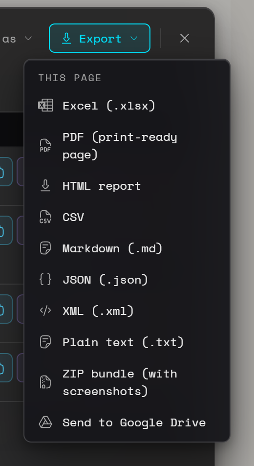

Your notes live in your browser, but you can take them anywhere. Every export and copy works offline, except **Send to Google Drive**.

There are three ways out:

- **Export** downloads a file.
- **Copy as** puts all your notes on the clipboard in a structured text format.
- **Copy** and **Copy image** on a single note copy just that note.

## What gets exported: scope

- **Sidebar → Export** always exports the notes on **this page**. The menu is headed **This page**.
- **Table view → Export** and **Table view → Copy as** follow the table's **This page / All pages** toggle. Each menu names its scope at the top: **This page** or **All pages**.
- **Search and category filters are not applied.** If you have typed a search or picked a filter chip, the menu heading adds "· search/filter not applied" so you know you are getting everything in that scope.
- **Every row carries its page URL**, so an **All pages** export says where each note was made.

"This page" means the exact page address without its `#fragment`.

If there is nothing to export, the toast reads "No annotations to export on this page." or "No annotations across all pages."

## File names

Every download is named:

```text
bluelines-<host>-<scope>-<date>.<extension>
```

- `<host>` is the host name of the page you exported from.
- `<scope>` is `current-page` or `all-pages`.
- `<date>` is today's date as `YYYY-MM-DD`.

For example:

```text
bluelines-localhost-current-page-2026-10-22.xlsx
bluelines-staging.shop.com-all-pages-2026-10-22.zip
```

## Export formats



Open **Export** in the sidebar header or the table view header. The menu offers, in this order:

### Excel (.xlsx)

A real spreadsheet with each screenshot **embedded as an image** in the Screenshot column, sized to fit its row. Open it in Excel, Google Sheets or Numbers.

The sheet is named **Annotations** and has these columns:

| # | Screenshot | Type | Note | Page | Location | Marked at |
|---|---|---|---|---|---|---|

- **Type** is the category label (for example **Layout Bug** or your own category).
- **Location** is the element's CSS selector, or "No location" for a general note.
- **Marked at** is the date and time in your local format.
- A note without a screenshot shows "—" in the Screenshot column.

The toast tells you how many notes and images were exported. The spreadsheet is built in your browser with no outside service.

### PDF (print-ready page)

Bluelines downloads a file ending in `-print.html`:

```text
bluelines-localhost-current-page-2026-10-22-print.html
```

1. Open the downloaded file in your browser.
2. The print dialog opens by itself.
3. Choose **Save as PDF** as the destination and save.

The page is laid out for A4, with a title, the scope and export time, a count per built-in category, and the notes table with screenshots. Rows are kept whole across page breaks.

### HTML report

A standalone `.html` file titled **Bluelines export**, with the scope and export time and the full table: number, screenshot, type, note, location and when it was marked. **All pages** exports add a Page column and group rows under a heading per domain. Screenshots are inline, so the file works on its own. Open it in any browser or attach it to an email.

### CSV

A plain `.csv` file with these columns:

```text
"#","Type","Note","Selector","Page","Marked At","Has Screenshot"
```

- Every cell is wrapped in double quotes, and quotes inside a value are doubled.
- **Marked At** is an ISO date and time, for example `2026-10-22T09:41:00.000Z`.
- **Has Screenshot** is `Yes` or `No`. CSV can't hold images.

**Formula defusing:** a value that starts with `=`, `+`, `-` or `@` (or a tab or carriage return) gets a leading `'`. Spreadsheet apps then show it as text instead of running it as a formula. For example, a note that reads `=SUM(A1:A9) is wrong` is written as:

```text
"'=SUM(A1:A9) is wrong"
```

This keeps a note, or a custom category name, from running as a formula when someone opens the file.

### Markdown (.md), JSON (.json), XML (.xml), Plain text (.txt)

The same text as **Copy as** (below), saved as a file instead of copied.

### ZIP bundle (with screenshots)

One `.zip` with everything, including the screenshots as separate image files:

```text
bluelines-localhost-current-page-2026-10-22.zip
├── annotations.json
├── report.html
└── screenshots/
    ├── screenshot-1.png
    ├── screenshot-3.png
    └── …
```

- `annotations.json` is the same JSON as **Copy as JSON**.
- `report.html` is the same table as the **HTML report**.
- `screenshots/screenshot-N.png`: `N` is the note's `index` in `annotations.json`. Notes without a screenshot have no file, so numbers can skip.

The toast says how many notes and screenshots went in. Use the ZIP as a backup: Bluelines has no sync between devices.

### Send to Google Drive

Uploads the same **Excel (.xlsx)** file to your Google Drive and opens it in a new tab. It needs a one-time setup. See [Google Drive](/docs/google-drive).

The first time, Bluelines asks:

```text
Send to Google Drive uploads an Excel file of these notes, including their screenshots, page addresses and element selectors, to your Google Drive. Bluelines can only see files it creates there.

Continue? You won't be asked again.
```

You see "Building spreadsheet…", "Connecting to Google Drive…" and then "Saved to Google Drive ✓ — *N* annotations". If it fails, the toast reads "Drive upload failed:" followed by the reason.

## Copy as: all notes in a structured format

In the table view header, open **Copy as** and pick a format. Bluelines copies every note in the current scope and shows "Copied *N* annotations as *Format*".

The format you pick also becomes the format of each note's **Copy** button, and the menu button then reads, for example, **Copy as MD**. In the sidebar, the same choice is in the **Copy button format** menu in the header. Both places share one setting.

Text formats carry a `hasScreenshot` flag (or a "Screenshot: yes/no" line), not the image itself. The images are in the Excel, HTML, PDF and ZIP exports.

The formats are:

| Format | What it is |
|---|---|
| **JSON** | Structured data for scripts and tools. |
| **Markdown** | Headings and bullet lists, for READMEs, issues and docs. |
| **Plain text** | Markdown with the formatting removed. |
| **XML** | Structured data for tools that expect XML. |
| **Notion** | Markdown with one quote block per note, for pasting into a Notion page. |
| **Linear** | One issue-style section per note, with `[Bug]`, `[Improvement]`, `[Task]` or `[Note]` in the title. |
| **Jira** | The same, in Jira's wiki markup (`h1.`, `h2.`, `*bold*`). |

**Notion**, **Linear** and **Jira** are on by default. You can add GitHub issue, GitLab issue, Slack, Discord, Trello and Email, or remove any of them, with **Add apps…** at the bottom of the menu. See [Share to apps](/docs/share-to-apps).

### Markdown

```markdown
# Bluelines annotations

- **Page:** http://localhost:3000/checkout
- **Exported:** 22/10/2026, 09:41:00
- **Count:** 2

## 1. Layout Bug

- **Note:** Pay button overlaps the card field on mobile
- **Location:** `[data-testid="pay-now"]`
- **Page:** http://localhost:3000/checkout
- **Marked at:** 2026-10-22T09:30:12.000Z
- **Screenshot:** yes

## 2. Text Annotation

- **Note:** Typo: "Chekout"
- **Location:** `h1`
- **Page:** http://localhost:3000/checkout
- **Marked at:** 2026-10-22T09:32:40.000Z
- **Screenshot:** no
```

### JSON

```json
{
  "scope": "current-page",
  "page": "http://localhost:3000/checkout",
  "exportedAt": "2026-10-22T09:41:00.000Z",
  "count": 2,
  "annotations": [
    {
      "index": 1,
      "type": "bug",
      "typeLabel": "Layout Bug",
      "note": "Pay button overlaps the card field on mobile",
      "selector": "[data-testid=\"pay-now\"]",
      "pageUrl": "http://localhost:3000/checkout",
      "markedAt": "2026-10-22T09:30:12.000Z",
      "hasScreenshot": true
    }
  ]
}
```

For **All pages**, `scope` is `all-pages` and `page` is `All pages`. A general note has `"selector": null`.

### XML

```xml
<?xml version="1.0" encoding="UTF-8"?>
<annotations scope="current-page" page="http://localhost:3000/checkout" exportedAt="2026-10-22T09:41:00.000Z" count="1">
  <annotation index="1" type="bug">
    <typeLabel>Layout Bug</typeLabel>
    <note>Pay button overlaps the card field on mobile</note>
    <location>[data-testid=&quot;pay-now&quot;]</location>
    <pageUrl>http://localhost:3000/checkout</pageUrl>
    <markedAt>2026-10-22T09:30:12.000Z</markedAt>
    <hasScreenshot>true</hasScreenshot>
  </annotation>
</annotations>
```

### Notion

```markdown
# Bluelines Annotations

**Page:** http://localhost:3000/checkout
**Exported:** 22/10/2026, 09:41:00
**Count:** 1

## 1. 🐛 Layout Bug

> **Note:** Pay button overlaps the card field on mobile
> **Location:** `[data-testid="pay-now"]`
> **Page:** http://localhost:3000/checkout
> **Marked at:** 2026-10-22T09:30:12.000Z
> **Screenshot:** Yes
```

Each heading gets an icon by category: 🐛 Layout Bug, 💡 Suggestion, 📝 Text Annotation, and 📌 for General Note and your own categories.

### Linear

```markdown
# Bluelines Annotations for Linear

**Source:** http://localhost:3000/checkout
**Exported:** 22/10/2026, 09:41:00

## 1. [Bug] Layout Bug: Pay button overlaps the card field on mobile

**Description:**
Pay button overlaps the card field on mobile

**Location:** [data-testid="pay-now"]
**Page:** http://localhost:3000/checkout
**Marked at:** 2026-10-22T09:30:12.000Z
**Screenshot:** Yes

---
```

### Jira

```text
h1. Bluelines Annotations for Jira

*Source:* http://localhost:3000/checkout
*Exported:* 22/10/2026, 09:41:00

h2. [Bug] Layout Bug: Pay button overlaps the card field on mobile

*Description:*
Pay button overlaps the card field on mobile

*Location:* [data-testid="pay-now"]
*Page:* http://localhost:3000/checkout
*Marked at:* 2026-10-22T09:30:12.000Z
*Screenshot:* Yes

----
```

In Linear and Jira, the issue type comes from the category: Layout Bug → `[Bug]`, Suggestion → `[Improvement]`, Text Annotation → `[Task]`, General Note → `[Note]`, and your own categories → `[Task]`. Titles are cut at 80 characters.

> **Note:** The "Exported" time uses your browser's local date format, so it may look different from these examples.

## Copy one note

Each note card and table row has two copy buttons.

**Copy** copies that one note in your chosen copy format. In the default JSON format it copies:

```json
{
  "type": "bug",
  "text": "Pay button overlaps the card field on mobile",
  "selector": "[data-testid=\"pay-now\"]",
  "url": "http://localhost:3000/checkout",
  "timestamp": 1792661412000
}
```

In any other format, you get that format for a single note.

**Copy image** copies only the screenshot, as a PNG image. Paste it straight into Figma, Slack, Google Docs or any app that accepts images. It copies the image alone, with no text alongside, so these apps paste the picture and not the note's text. The button appears only on notes that have a screenshot.

After either copy, the note shows a green **Copied** badge. It stays, so you can see which notes you've already handed off. Hover it to see when.

Copy and Copy image work on notes from the page you are on. In the table's **All pages** view, they are disabled for notes from other pages.

> **Note:** If the page blocks the clipboard, you see "Copy failed: the clipboard is blocked on this page." Click the page and try again.

## Related

- [Share to apps](/docs/share-to-apps)
- [Google Drive](/docs/google-drive)
- [Table view](/docs/table-view)
- [Privacy](/docs/privacy)
