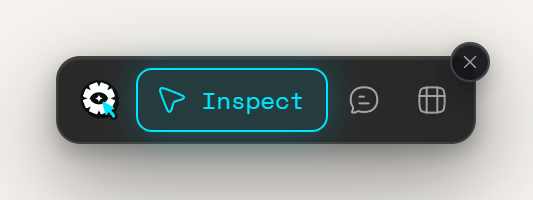
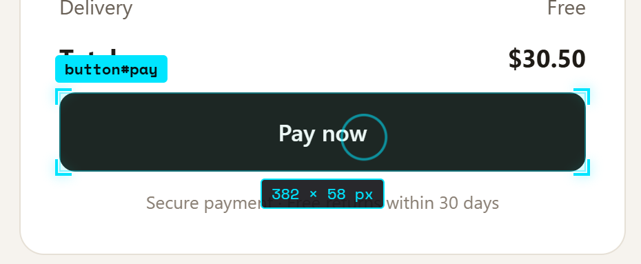

Inspect Mode is how you choose what a note is about. While it's on, Bluelines outlines the element under your pointer. Click it and the note callout opens.

## The dock

The dock is the small floating bar Bluelines adds to every page. From left to right (or top to bottom when it's docked at a side):

| Control | What it does |
|---|---|
| Bluelines mark | Drag handle. Drag it to move the dock. Tooltip: *Drag to move*. |
| **Inspect** | Turns Inspect Mode on or off. Lit while Inspect Mode is on. |
| **Annotations sidebar** (speech bubble, no label) | Opens or closes the sidebar. Its badge shows how many notes this page has (up to **99+**). |
| **Table view** | Opens or closes the [table view](/docs/table-view). |
| **✕** | Hides the dock. |

When you hide the dock, Bluelines says: *Dock hidden. Press Alt+Shift+H, or use the toolbar icon → Open sidebar, to bring it back.* The dock stays hidden on every page until you bring it back.

## Turn Inspect Mode on and off

Turn it on in any of these ways:

- Click **Inspect** in the dock.
- Press <kbd>Alt</kbd>+<kbd>Shift</kbd>+<kbd>M</kbd>.
- Click **Inspect Mode** in the toolbar popup.

A message confirms it: *Inspect Mode: click any element, or Tab to one and press Enter. Esc to stop.*

Turn it off by pressing <kbd>Esc</kbd>, clicking **Inspect** again or pressing <kbd>Alt</kbd>+<kbd>Shift</kbd>+<kbd>M</kbd> again. Picking an element also turns it off.

> **Note:** While Inspect Mode is on, clicks on the page don't reach the page. Links don't open and buttons don't fire. Clicks on Bluelines' own dock and panels still work.

## Hover chips

As you move the pointer, the element under it gets:

- an outline with corner brackets,
- a **selector chip** above it, such as `button.cta` or `div#hero` (the tag plus its id, or its first class),
- a **size chip** below it, such as `320 × 48 px`.

Near the top or bottom of the window the chips move inside the element so they stay visible. A ring trails your pointer. With reduced motion (your system setting or **Settings → Appearance → Motion → Reduced**), the ring doesn't trail.

## Click to mark

Click the element. Bluelines:

1. turns Inspect Mode off,
2. locks the outline on that element,
3. opens the note callout beside it, joined by a connector line.

Write your note and save it. See [Notes and categories](/docs/notes-and-categories).

## Dropdowns, popups and modals

Some page UI closes as soon as you click anywhere, such as a dropdown menu or a hover popup. Clicking **Inspect** in the dock would close it first.

1. Open the menu, popup or dialog on the page.
2. Press <kbd>Alt</kbd>+<kbd>Shift</kbd>+<kbd>M</kbd>. The shortcut doesn't click anything, so the menu stays open.
3. Click the element inside it.

When the page shows a modal `<dialog>`, the rest of the page stops responding to clicks and typing. Bluelines moves its own UI into the open dialog so the dock, callout and sidebar keep working.

## Mark with the keyboard

1. Press <kbd>Tab</kbd> until the **Inspect** button in the dock is focused, then press <kbd>Enter</kbd>. Or press <kbd>Alt</kbd>+<kbd>Shift</kbd>+<kbd>M</kbd>.
2. Press <kbd>Tab</kbd> to move through the page. Each focused link, button or field is outlined with its chips.
3. Press <kbd>Enter</kbd> to mark the focused element.

Plain text can't take keyboard focus. To comment on it from the keyboard, use a [general note](#general-notes) instead. See [Keyboard shortcuts](/docs/keyboard-shortcuts) for full keyboard-only use.

## General notes

A general note isn't tied to an element. Use it for page-wide feedback.

1. Open the sidebar.
2. Click **+** in the sidebar header (tooltip: *Add a general note without a specific location*).
3. The callout's caption says *General note · no location*. Write and save.

General notes have no screenshot and no page pin, and they never show **Element not found**.

## Screenshots

When you save a note on an element, Bluelines takes a screenshot of the visible window and crops it to that element.

- If the element has scrolled out of view, Bluelines scrolls it back into view first.
- Only the visible part of the window is captured. An element taller or wider than the window is cut off at the window's edge.
- If the capture fails, the note still saves, and the message says *Annotation saved without a screenshot*.
- Re-pinning a note keeps its original screenshot.

## How notes stay attached

Pages change. Bluelines saves three things about each element so it can find it again:

| What | What it is |
|---|---|
| **Selector** | A CSS selector. Bluelines prefers a stable `id`, then test or ARIA attributes, then a meaningful class. It skips generated ids and CSS-in-JS class names. As a last resort it uses an `nth-child` path. |
| **Fingerprint** | The element's tag, a hash of its text, its position among its siblings and its parent. |
| **Anchor words** | A plain-words description, such as `button "Pay now" in form "Payment" under "Checkout"`. AI agents use it to find the matching code. |

When you jump to a note, Bluelines tries the selector first. A position-based path only counts if the element still looks like the saved one. If the selector fails, it looks for a single element that matches the fingerprint. If that's what it found, it says: *Matched approximately: the page changed since this note was made. Check it is the right element.*

If nothing matches, Bluelines doesn't guess. The card shows **Element not found** and offers **Re-pin**. See [Sidebar and status](/docs/sidebar-and-status#element-not-found-and-re-pin).

> **Note:** Notes belong to the page's exact address without the `#` part. Hash-routed apps share one set of notes across routes, and the same page with different query strings has separate sets. Iframes and shadow DOM aren't supported.

## Move the dock

Drag the Bluelines mark at the start of the dock. When you let go, the dock snaps to the nearest edge of the window: it sits upright at the left or right edge and lies flat at the top or bottom. The position lasts until the page reloads; each new page starts with the dock at the bottom centre.

With the keyboard:

1. Tab to the Bluelines mark and press <kbd>Enter</kbd> or <kbd>Space</kbd>.
2. Move it with the arrow keys, 10 px at a time. Hold <kbd>Shift</kbd> to move 50 px.
3. Press <kbd>Enter</kbd> or <kbd>Space</kbd> to drop it. It snaps to the nearest edge.
4. Press <kbd>Esc</kbd> instead to cancel and put it back.

If you make the window smaller, the dock moves to stay on screen.
