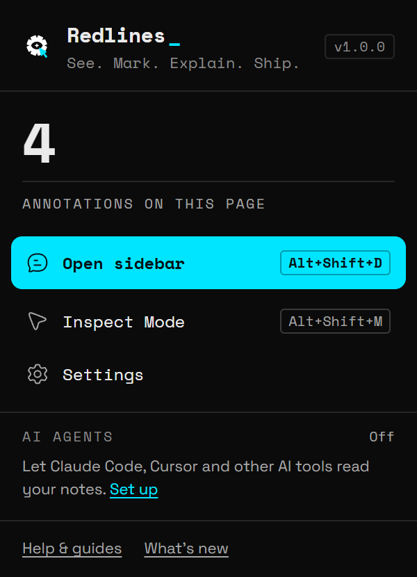

Bluelines is a Manifest V3 extension. One build works in Chrome, Edge and other Chromium browsers. There is no build step.

> **Note:** When you install Bluelines for the first time, it opens the [Quickstart](/docs/quickstart) in a new tab.

## Option 1: from a store

1. Open the Bluelines listing:
   - **Edge Add-ons** (coming soon)
   - **Chrome Web Store** (coming soon)
2. Click **Get** (Edge) or **Add to Chrome** (Chrome).
3. Confirm the permission prompt.
4. [Pin Bluelines to the toolbar](#pin-bluelines-to-the-toolbar).

Store installs update themselves. Brave and Arc can install from the Chrome Web Store too.

## Option 2: load unpacked (Chrome, Edge, Brave, Arc)

Use this before the store listings are live, or to run a specific version.

### Get the files

Pick one:

- **Download the ZIP:** [bluelines-main.zip](https://github.com/varulverma/bluelines/archive/refs/heads/main.zip) from GitHub, then unzip it. You get a folder called `bluelines-main`.
- **Clone with git:** run this in a terminal. You get a folder called `bluelines`.

  ```bash
  git clone --depth 1 https://github.com/varulverma/bluelines.git
  ```

Keep that folder somewhere you won't clear, such as your Documents folder, not Downloads. Inside it is a folder called `extension`, the one that contains `manifest.json`: this guide calls it the Bluelines folder.

> **Tip:** Keep this folder where it is. The browser runs Bluelines from it, and the AI agent bridge lives inside it at `mcp/bluelines-mcp.js`.

### Load it

1. Open the extensions page. Paste the address for your browser into the address bar.

   Chrome, Brave and Arc:

   ```text
   chrome://extensions
   ```

   Edge:

   ```text
   edge://extensions
   ```

2. Turn on **Developer mode**. In Chrome it's a switch at the top right. In Edge it's in the left column.
3. Click **Load unpacked**.
4. Select the Bluelines folder (`extension`, inside `bluelines-main` or `bluelines`) and confirm.
5. Bluelines appears in the list as **Bluelines — Visual Annotation Tool**.

> **Note:** Brave and Arc are Chromium browsers and are expected to behave like Chrome, but they are not yet verified. See [Browser support](/docs/browser-support).

## Pin Bluelines to the toolbar

1. Click the puzzle-piece **Extensions** icon in the toolbar.
2. Click the pin next to **Bluelines**.

The Bluelines icon opens the toolbar popup. It shows how many notes the current page has, plus **Open sidebar**, **Inspect Mode**, **Settings** and the **AI agents** strip. The strip says **Off** while AI agent access is off, **0 connected** once it's on but no agent has connected yet, then shows a chip for each connected agent that blinks while it's working. At the bottom, **Help & guides** opens these docs and **What's new** opens the changelog. See [AI agents](/docs/ai-agents).

## Allow access to file URLs

Bluelines can annotate local `.html` files (`file://` pages), but the browser blocks this by default.

1. Open the extensions page (`chrome://extensions` or `edge://extensions`).
2. Click **Details** on Bluelines.
3. Turn on **Allow access to file URLs**.
4. Reload your local page.

Until you do this, the popup says: *To annotate local files, turn on "Allow access to file URLs" for Bluelines in chrome://extensions.*

## Tabs that were open before you installed

Browsers only add an extension to pages that load after it's installed. Tabs that were already open don't have Bluelines yet.

You don't need to reload them. Bluelines adds itself to a tab the first time you use the toolbar popup or a [keyboard shortcut](/docs/keyboard-shortcuts) there.

The same applies after Bluelines updates or reloads. If a tab still shows the old dock, clicking it shows: *Bluelines was updated. Refresh this page to keep annotating.* Refresh the page.

## Pages Bluelines can't annotate

Browsers don't let extensions run on some pages:

- Browser pages, such as `chrome://` and `edge://` pages.
- Extension stores, such as the Chrome Web Store and Edge Add-ons.
- Local `file://` pages, until you [allow access to file URLs](#allow-access-to-file-urls).

On these pages the popup shows **—** instead of a count, says *Bluelines can't run on this page (browser pages and extension stores are off-limits).*, and disables **Open sidebar** and **Inspect Mode**.

Bluelines also can't pick elements inside iframes or shadow DOM.

## Firefox (experimental)

The manifest includes Firefox settings (Firefox and Zen 121 or later), but Bluelines has not been tested in Firefox yet. Expect rough edges.

1. Open the debugging page:

   ```text
   about:debugging#/runtime/this-firefox
   ```

2. Click **Load Temporary Add-on**.
3. Select `manifest.json` inside the Bluelines folder.
4. If Firefox asks for site access, grant it. Firefox makes site access opt-in, so Bluelines does nothing on a page until you allow it.

> **Note:** Firefox removes temporary add-ons when it restarts. Copying a screenshot as an image needs Firefox 127 or later. For Google Drive, register the redirect URL that the Settings page shows in Firefox, because it differs per browser.

## Check that it works

1. Open any normal web page, such as a site you're working on.
2. Look for the Bluelines dock, a small floating bar at the edge of the page.
3. Click the Bluelines toolbar icon. The popup shows **0** and *Annotations on this page*.
4. Press <kbd>Alt</kbd>+<kbd>Shift</kbd>+<kbd>M</kbd>. A message says *Inspect Mode: click any element, or Tab to one and press Enter. Esc to stop.*
5. Press <kbd>Esc</kbd> to leave Inspect Mode.



If nothing happens, see [Troubleshooting](/docs/troubleshooting). Next, [write your first note](/docs/quickstart).

## Update Bluelines

### Store installs

The store updates Bluelines automatically. Refresh open tabs afterwards, or use the popup or a shortcut in each tab to load the new version.

### Unpacked installs

1. If you cloned with git, run `git pull` inside the Bluelines folder. If you downloaded the ZIP, download [the latest ZIP](https://github.com/varulverma/bluelines/archive/refs/heads/main.zip) and replace the files in your existing Bluelines folder with the new ones. Keep the same folder.
3. Open the extensions page:

   ```text
   chrome://extensions
   ```

4. Click the reload arrow on the Bluelines card.
5. Refresh any tab where you want to keep annotating.

Your notes and settings are kept. They live in the browser's extension storage, not in the folder.

> **Note:** Browsers apply the suggested keyboard shortcuts only on a fresh install. If you installed an earlier build, set the shortcuts once on the shortcuts page:
>
> ```text
> chrome://extensions/shortcuts
> ```

> **Tip:** If you use [Google Drive](/docs/google-drive), the redirect URI depends on the extension ID. An unpacked build loaded on another machine gets a different ID, so update the redirect URI in Google Cloud Console if it changes.

## Uninstall

1. Open the extensions page (`chrome://extensions` or `edge://extensions`).
2. Click **Remove** on Bluelines and confirm.

**What happens to your data:** removing the extension deletes everything it stored in this browser: every note, screenshot, category and setting, plus your Enhance API key and Google Drive sign-in. There is no undo.

> **Tip:** Before you uninstall, export a ZIP bundle from the table view to keep a copy. See [Export and share](/docs/export-and-share) and [Back up and move your notes](/docs/guide-backup-move).

If you connected an AI tool, its MCP entry for Bluelines stays in that tool's own config. Remove the `bluelines` entry there.

## Optional extras

None of these are needed to mark up pages.

### AI agents: Node.js 18 or later

The AI agent bridge runs with Node.js. Check your version in a terminal:

```bash
node --version
```

You need `v18` or higher. Then follow [AI agents](/docs/ai-agents).

### Enhance: your own API key

Enhance uses your own key from Anthropic, OpenAI or OpenRouter. Add it in **Settings → AI Enhance**. See [Enhance](/docs/enhance).

### Google Drive: a one-time setup

Sending the Excel audit to Drive needs your own OAuth client ID. See [Google Drive](/docs/google-drive).
