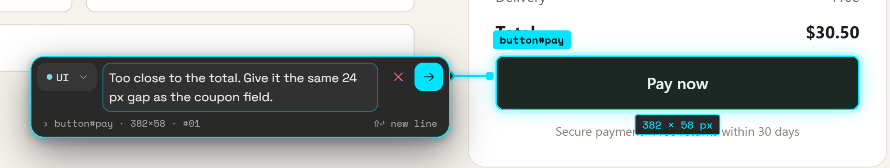

When you pick an element in [Inspect Mode](/docs/inspect-mode), a note callout opens beside it. This page covers writing the note, choosing a category and changing the note later.

## The note callout

The callout is one line, joined to the element by a connector line.

| Part | What it does |
|---|---|
| **Category chip** | Shows the category the note will be saved in. Its arrow opens the category menu. |
| **Note field** | Says *What should change here?* Grows to about seven lines as you type. |
| **✕** | Cancels and discards the note. Tooltip: *Cancel and discard this note (Esc)*. |
| **Save** (arrow) | Saves the note. |

Under the line, a caption shows where the note goes, for example `› button.cta · 320×48 · #04`: the element, its size and the number the note will get. For a general note it says *General note · no location*. While you type, *⇧↵ new line* appears as a reminder.

Bluelines places the callout to the right of the element, or to the left, below or above if there's no room. It keeps clear of the open sidebar. When you scroll, the connector line follows the element.

Once you've typed something, the whole callout lights up with the accent colour, and so do the element outline and the connector.

> **Note:** Clicking outside the callout closes it without saving.

## Save

- Press <kbd>Enter</kbd> or click **Save**.
- Press <kbd>Shift</kbd>+<kbd>Enter</kbd> for a new line.

Save looks faded until you've typed something. Its tooltip says *Write a note first, then save it (Enter)*. It stays focusable, so keyboard users can still reach it. If you try to save an empty note, the callout shakes and says *Please add a comment before saving.*

After saving, Bluelines says **Annotation saved**, takes the screenshot and adds the note to the sidebar. The callout closes and focus returns to where you were.

## Categories

Every note has one category. It sets the colour of the note's number and pin (with **Settings → Workspace → Note colours → By category**), and you can filter the table by it.

### Your starting category

A new install has one category, **UI**. New notes use the first category in your list unless you pick another.

### Built-in categories

Bluelines has four built-in categories with fixed colours. They show with these labels:

| Category | Label |
|---|---|
| `bug` | **Layout Bug** |
| `suggestion` | **Suggestion** |
| `text` | **Text Annotation** |
| `note` | **General Note** |

They aren't in the list on a new install. To use one, add it with the name `Bug`, `Suggestion`, `Text` or `Note` (any case). Bluelines then shows its label and colour. Notes saved in these categories by older versions keep them.

### Custom categories

1. Click the arrow on the category chip.
2. Click **+** (tooltip: *Add a new category*).
3. Type a name, such as `Copy` or `Layout`, and press <kbd>Enter</kbd>.

The new category is selected and added to your list. Your list is shared by every page. If you type a name that already exists, ignoring case, Bluelines selects the existing one instead of making a duplicate. Each custom category gets its own colour, worked out from its name.

### The category chip and its menu

The chip shows the current category's name and a small arrow.

- **The arrow** opens the menu (tooltip: *Choose or add a category*). The menu lists your categories, a **+** to add one, and **Rename "‹name›"**. Pick a category and the menu closes.
- **The name** is plain text. Clicking it does nothing. Double-click it to rename the category (tooltip: *Double-click to rename this category*).

The menu is always closed when the callout opens. Press <kbd>Esc</kbd> to close the menu without closing the callout.

### Rename a category everywhere

1. Double-click the category name on the chip, or open the menu and click **Rename "‹name›"**.
2. Type the new name. It can be up to 24 characters.
3. Press <kbd>Enter</kbd>, or click away, to save. Press <kbd>Esc</kbd> to cancel.

Bluelines renames the category in your list and in **every saved note in that category, on every page**. It says *Renamed ‹old› to ‹new›*. If the new name is already taken, it says *"‹name›" already exists.* and changes nothing.

### Settings → Annotations

Open **Settings** from the toolbar popup and go to **Annotations**.

| Control | What it does |
|---|---|
| **Categories: Hide / Show** | Shows or hides the category picker in the **Edit** dialog only. The note callout always shows its category chip. Applies to the next form you open. Default: **Hide**. |
| **Your categories** | Your list. Edit a name to rename it: notes already in it move with it. Delete one and its notes keep the old name. You must keep at least one category. |
| **New category** + **Add** | Adds a category to the end of the list. |

## Send to an agent from the callout

If you've connected AI agents, each connected agent appears as a small logo button at the right end of the caption line. Its tooltip says *Send to ‹agent› when you save*.

1. Click an agent's button to pick it. Click it again to unpick it. You can pick one agent per note.
2. Save. Bluelines says **Annotation sent to ‹agent›**.

If no agent is connected, the buttons don't appear. To set agents up, see [AI agents](/docs/ai-agents). To send or take back a saved note, see [Send to agent](/docs/send-to-agent).

## Edit a note

1. In the sidebar or table, click **Edit** (amber pencil) on the note.
2. The **Edit annotation** dialog opens with your text.
3. Change the text. If **Settings → Annotations → Categories** is set to **Show**, you can also pick a different category.
4. If agents are connected, or the note was already sent to one, you can change or clear the agent here too.
5. Press <kbd>Enter</kbd> or click **Save**. Click **Cancel** or press <kbd>Esc</kbd> to leave it unchanged.

Bluelines says **Annotation updated**. The note keeps its category unless you pick another one, and keeps its original **Marked at** time. The time of the edit is stored separately.

You can only edit notes on the page you're on. See [Table view](/docs/table-view#notes-on-other-pages).

## Delete a note and undo

1. Click **Delete** (red bin) on the note.
2. The note is removed at once. There's no confirmation step.
3. A message says **Annotation deleted** with an **Undo** button. It stays for 6 seconds.
4. Click **Undo** to put the note back in its place. Bluelines says **Annotation restored**.
