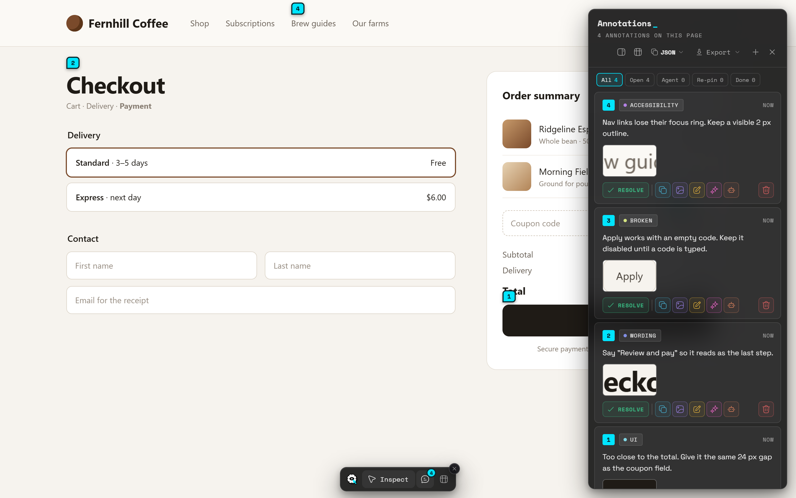

The sidebar lists every note on the page you're on, as cards. It's where you review, resolve, copy and hand off notes.

## Open the sidebar

- Click the speech-bubble button in the dock (tooltip: *Annotations sidebar (Alt+Shift+D)*).
- Press <kbd>Alt</kbd>+<kbd>Shift</kbd>+<kbd>D</kbd>.
- Click **Open sidebar** in the toolbar popup.

The sidebar shows the notes for this page's exact address, without the `#` part. Its header says how many there are, for example *3 annotations on this page*. Newest notes are at the top.

The sidebar and the [table view](/docs/table-view) don't open together. Opening one closes the other.

### Header buttons

| Button | What it does |
|---|---|
| Rail icon | Switches between the compact rail and the full panel. Tooltip: *Compact view (collapse to a rail)* or *Expand to full sidebar*. |
| Table icon | Opens the [table view](/docs/table-view). Tooltip: *View as table*. |
| **Copy format** (shows **JSON** by default) | Picks the format the **Copy** button uses. See [Export and share](/docs/export-and-share). |
| **Export** | Exports this page's notes. See [Export and share](/docs/export-and-share). |
| **+** | Adds a [general note](/docs/inspect-mode#general-notes). |
| **✕** | Closes the sidebar. |

### Empty page

With no notes yet, the sidebar says **No annotations on this page yet**: *Turn on Inspect in the dock (or press Alt+Shift+M) and click any element. Use + above for a general note without a location.* It links to the **Quickstart guide**.

## Compact rail or full panel

The sidebar has two widths:

- **Compact rail** (the default): a slim column of numbered dots. Hover it, or move keyboard focus into it, and it expands to the full panel.
- **Full panel**: the cards are always fully shown.

Switch with the rail icon in the header. Bluelines remembers your choice on every page. You can also set it in **Settings → Workspace → Sidebar opens as**. See [Workspace](/docs/workspace).

## Page pins

While the sidebar is open, a numbered pin marks each annotated element on the page. The number matches the note's card. Numbers count up in the order you made the notes.

- Hover a pin to see the start of the note.
- Click a pin to scroll to its element and highlight its card in the sidebar.

Pins hide during Inspect Mode. To turn them off, use **Settings → Workspace → Page pins → Hide**.

## Jump to an element

Click a card, or its number chip (tooltip: *Go to this element on the page*). The page scrolls to the element and it pulses briefly. The card is marked as the one you're on.

## Element not found and Re-pin

If the page has changed and Bluelines can't find a note's element, it doesn't point at the wrong one. Instead:

- The card gets an **Element not found** tag. Tooltip: *The page changed and this note's element can't be found. Re-pin it.*
- Clicking the card scrolls to where the element used to be, if Bluelines knows, and says *Couldn't find this element: the page has changed since the note was made.* with a **Re-pin** button.
- The card shows a labelled **Re-pin** button.

To re-pin:

1. Click **Re-pin** (tooltip: *Re-pin: click the element this note belongs to*).
2. Inspect Mode turns on, and Bluelines says *Re-pin: click the element this note belongs to. Esc to cancel.*
3. Click the right element. Bluelines says *Note re-pinned to this element*.

Re-pinning keeps the note's text, category and original screenshot. Press <kbd>Esc</kbd> to cancel.

## Status filters

Under the header, filter chips show how many notes fall into each status. Click one to show only those notes.

| Filter | Shows | Tooltip |
|---|---|---|
| **All** | Every note on this page. | *Show every note on this page* |
| **Open** | Notes that aren't resolved and whose element was found. | *Show notes that are still open* |
| **Agent** | Unresolved notes you sent to an AI agent. | *Show open notes sent to an AI agent* |
| **Re-pin** | Unresolved notes whose element can't be found. | *Show notes whose element was not found* |
| **Done** | Resolved notes. | *Show resolved notes* |

If nothing matches, the sidebar says *No notes match this filter.* The chips are hidden when the page has no notes, and in the compact rail until it expands.

> **Note:** The table view doesn't have status filters yet. It has category filters instead.

## Resolve and reopen

When a note is dealt with, resolve it:

1. Click **Resolve** (green, with a check mark).
2. Bluelines says **Marked resolved**. The card gets a **Resolved** tag and moves to the **Done** filter.

To bring it back, click **Reopen** on the card. Bluelines says **Reopened** and the note returns to **Open**.

Resolved notes appear dimmed in the [table view](/docs/table-view). AI agents can also resolve and reopen notes if you allow it. See [AI agents](/docs/ai-agents).

## Card actions

Each card has a row of colour-coded buttons. They're slightly muted until you're on that card. Hover or focus a button to see its tooltip.

| Button | Colour | Tooltip | What it does |
|---|---|---|---|
| **Resolve** / **Reopen** | Green | *Mark as resolved: moves it to Done* / *Reopen: move it back to Open* | Changes the note's status. |
| **Re-pin** | Accent | *Re-pin: click the element this note belongs to* | Only on notes whose element is lost. |
| **Copy** | Blue | *Copy this note as JSON* (or the format you picked) | Copies the note as text. |
| **Copy image** | Violet | *Copy the screenshot as an image* | Copies the screenshot only. Shown when the note has one. |
| **Edit** | Amber | *Edit the note text* | Opens the [Edit dialog](/docs/notes-and-categories#edit-a-note). |
| **Enhance** | Pink | *Rewrite this note as an AI prompt with your AI provider (asks first)* | See [Enhance](/docs/enhance). |
| **Send to an AI agent** | Orange | *Send to an AI agent so it can pick this up* / *Sent to ‹agent›. Click to take it back.* | See below. |
| **Delete** | Red, at the far right | *Delete this note. You can undo right after.* | Deletes at once, with **Undo**. See [Delete a note and undo](/docs/notes-and-categories#delete-a-note-and-undo). |

### Send, take back and re-send

- **One agent connected:** click the orange button and the note is sent to it. Bluelines says **Sent to ‹agent›**.
- **Several agents connected:** the button opens a **Send to** menu. Pick one.
- **No agent connected:** Bluelines says *No AI agent is connected. Connect one in Settings → Connect to AI agents.*

A sent note shows the agent's name as a tag, and the orange button looks filled. Click it again to take the note back: Bluelines says **Took the note back from ‹agent›**. Click once more to re-send. See [Send to agent](/docs/send-to-agent).

## Copy and Copy image

- **Copy** puts the note on your clipboard as text, in the format shown on the header's copy format button. With the default **JSON**, that's the note's category, text, selector, page address and time. Bluelines says *Copied annotation as JSON*.
- **Copy image** puts only the screenshot on your clipboard, so it pastes as a picture in Figma, Slack or Google Docs. Bluelines says **Copied image**.

After either copy, the card shows a green **Copied** badge. It stays, so you can see which notes you've already handed off. Hover it to see when you copied it.

If the page blocks the clipboard, Bluelines says *Copy failed: the clipboard is blocked on this page.* Click the page and try again.

## Screenshot lightbox

Click a card's screenshot thumbnail (tooltip: *Open the screenshot larger*) to see it full size. Click anywhere or press <kbd>Esc</kbd> to close it. Focus returns to the thumbnail.

## Notes and replies from AI agents

When an AI agent works on your notes, its changes show in the sidebar straight away:

- A note an agent added has an **AI** tag. Tooltip: *Added by an AI agent*.
- Replies appear under the note text, each labelled **AI** or **You**.
- Notes an agent resolved move to **Done**, like any other.

Each card also shows how old the note is, such as **now**, **5m**, **3h** or **2d**. Hover it to see the full date and time it was marked.
