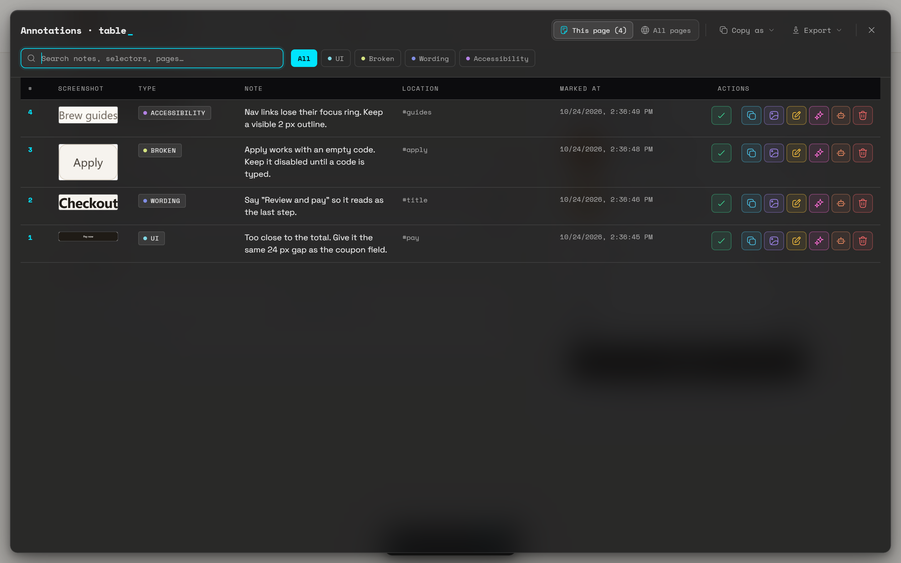

The table view shows your notes as rows in a full-screen table. Use it to review a lot of notes at once, to see notes from every page you've reviewed, and to export.

## Open the table

- Click the table icon in the sidebar header (tooltip: *View as table*).
- Click the **Table view** button in the dock.

The table and the sidebar don't open together: opening one closes the other. Focus goes to the search box.

To close it, click **✕** or press <kbd>Esc</kbd>. Focus returns to the dock's **Table view** button if you opened it there, otherwise to the dock's speech-bubble button (**Annotations sidebar**).

## Columns

| Column | Shows |
|---|---|
| **#** | The note's number chip. On **This page** it matches the sidebar card and page pin. |
| **Screenshot** | A thumbnail, or **—** if there's none. |
| **Type** | The category, in its colour. |
| **Note** | The note text, plus its **Copied**, **Resolved** and agent tags. |
| **Page** | The page's host name. Only in **All pages**. Hover it for the full address. |
| **Location** | The element's selector, or **No location** for a general note. |
| **Marked at** | The date and time the note was made. Edits don't change it. |
| **Actions** | The row's buttons. |

### Resize columns

- Drag the edge of a column header to resize it, between 40 and 600 px.
- Double-click the edge to reset that column. Bluelines says *Column width reset*.

Bluelines remembers your widths separately for **This page** and **All pages**.

## Search

Type in the box that says *Search notes, selectors, pages…*. The table filters as you type. It matches the note text, the selector, the page address and the category name.

## Category filters

The chips under the header filter by category: **All**, then each of your categories, then any other category found in the notes shown. Click one to show only that category.

> **Note:** The table has category filters only. The sidebar's status filters (**Open**, **Agent**, **Re-pin**, **Done**) aren't in the table yet.

## This page or All pages

The toggle in the header switches between:

| View | Shows |
|---|---|
| **This page** (count) | Notes on the page you're on. Tooltip: *Show annotations on this page only*. |
| **All pages** (count) | Every note Bluelines has stored in this browser, from every page. Tooltip: *Show all annotations across all pages, grouped by domain*. |

In **All pages**, rows are grouped under a header for each domain, such as `example.com`, with a count like *12 annotations*. Subdomains are grouped with their main domain, so `app.example.com` and `www.example.com` share one group. Domains are listed alphabetically, and within each group the oldest note comes first. **This page** lists the newest first.

## Row actions

Click a row to jump to its element, like clicking a sidebar card. Row actions are icon-only versions of the [card actions](/docs/sidebar-and-status#card-actions), with the same colours and tooltips:

| Button | What it does |
|---|---|
| **Resolve** / **Reopen** (green) | Resolves or reopens the note. |
| **Copy** (blue) | Copies the note in your copy format. |
| **Copy image** (violet) | Copies the screenshot. Shown when the note has one. |
| **Edit** (amber) | Opens the Edit dialog. |
| **Enhance** (pink) | Rewrites the note as an AI prompt. See [Enhance](/docs/enhance). |
| **Send to an AI agent** (orange) | Sends the note to an agent, or takes it back. See [Send to agent](/docs/send-to-agent). |
| **Delete** (red) | Deletes the note, with **Undo**. |

## Status tags and resolved rows

- A resolved note shows a **Resolved** tag next to its text, and its whole row is dimmed.
- A note sent to an agent shows the agent's name as a tag.
- A copied note shows the green **Copied** badge.

## Notes on other pages

In **All pages**, rows from other pages are there for reference. Their tooltip says *Annotation on another page*, and clicking them doesn't jump anywhere.

| You can | You can't |
|---|---|
| **Resolve** or **Reopen** | **Edit** |
| **Send** to an agent or take it back | **Copy** or **Copy image** |
| **Delete**, with **Undo** | **Enhance** |

The buttons you can't use are disabled. To edit or copy one of those notes, open its page.

## Export from the table

The header has two menus:

- **Copy as** copies every note at once as JSON, Markdown, XML or Plain text, or for one of the apps turned on in **Settings → Share to apps** (Notion, Linear and Jira by default). The format you pick also becomes the format of each note's **Copy** button. **Add apps…** opens **Settings → Share to apps**.
- **Export** downloads a file (Excel, PDF, HTML report, CSV, Markdown, JSON, XML, Plain text or a ZIP bundle with screenshots), or sends the Excel file to Google Drive.

Both menus use the **This page** / **All pages** toggle, and each says its scope at the top.

> **Note:** Search and category filters aren't applied to exports. When a search or filter is on, the menu heading says so, for example *This page · search/filter not applied*.

See [Export and share](/docs/export-and-share) and [Share to apps](/docs/share-to-apps) for each format.
